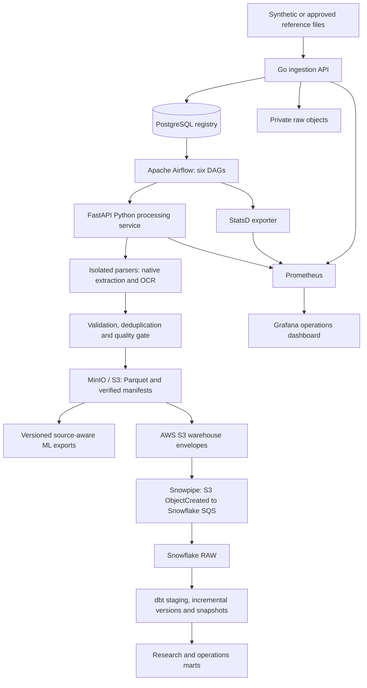
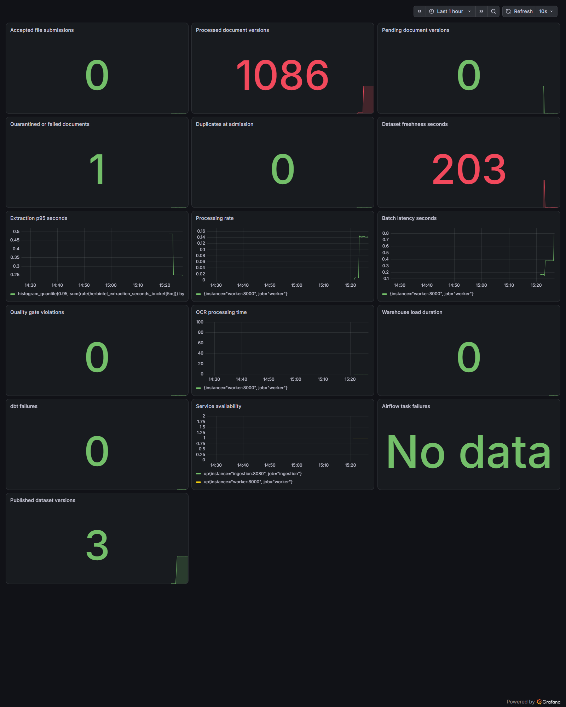
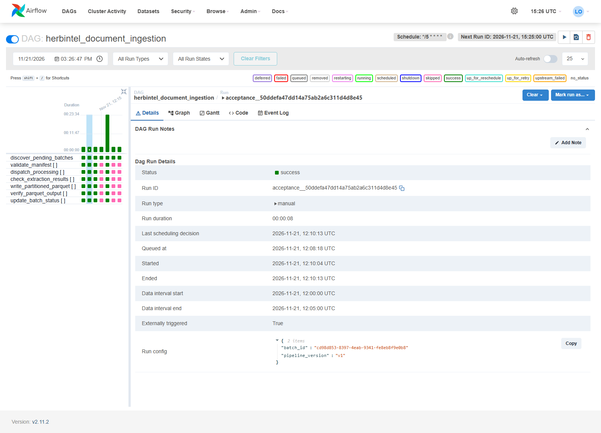

# HerbIntel Data Platform

Private repository: [i192009/herbintel-data-platform](https://github.com/i192009/herbintel-data-platform).

A reference-document data platform for producing validated, traceable research datasets. Go admits files and metadata, PostgreSQL owns operational state, Python extracts documents, and versioned Parquet and verified manifests are published to private object storage. Airflow orchestrates the work; real Snowflake integration and dbt models provide the analytical path.

This is a new portfolio implementation. It does **not** describe Snowflake, dbt or Airflow capabilities already deployed by the real HerbIntel organization. It produces no patient-specific advice and establishes no clinical correctness. Default inputs are deterministic synthetic educational documents.

**Validation:** see [IMPLEMENTATION_STATUS.md](IMPLEMENTATION_STATUS.md) and [the validation report](docs/validation.md). Service acceptance and benchmarks are reported separately from Airflow and cloud verification. A missing credential never becomes a simulated successful Snowflake load.

## Architecture



No vector-search service is added to the warehouse. Airflow sends IDs and small summaries through XCom; document bodies remain in storage and worker memory.

## Stack and repository

| Layer | Selected implementation |
|---|---|
| Admission | Go 1.26.10, standard HTTP router, pgx, MinIO SDK, bounded channels |
| Processing | Python 3.12, FastAPI, Pydantic v2, disposable parser processes |
| Extraction | pypdf, python-docx, Pillow, Poppler, Tesseract English and simplified Chinese |
| Persistence | PostgreSQL 16; separate ingestion and worker roles |
| Lake | Private MinIO locally; AWS S3 in the cloud; PyArrow Parquet |
| Orchestration | Airflow 2.11.2, LocalExecutor, PostgreSQL metadata |
| Warehouse | Snowflake Connector 5.2.0, actual external stage, five Snowpipe definitions |
| Analytics | dbt Core 1.12.7, dbt-snowflake 1.12.5 |
| Operations | Prometheus, Grafana, Airflow StatsD metrics |

Python direct requirements and the resolved transitive lock are in `services/processing-python/`. Docker tags, Go module sums and the MinIO source revisions are pinned. MinIO and mc are built from source because the selected upstream public image/binary endpoints could not be retrieved during implementation. First builds download substantial Go dependencies.

```text
services/ingestion-go/           API, admission control and registry tests
services/processing-python/     extraction, quality, exports, metadata API, warehouse connector
airflow/dags/                   six actual TaskFlow DAG definitions
dbt/herbintel/                  sources, 17 SQL models, snapshot and data tests
snowflake/                      provisioning, tables, IAM templates, stages, pipes, verification
storage/                        PostgreSQL bootstrap, private bucket policy and retention
monitoring/                     scrape rules, alerts, provisioned Grafana dashboard
scripts/                        cross-platform commands, acceptance, recovery and benchmarks
tests/                          Python unit and real-service integration assertions
docs/                           design, cloud runbook, validation and interview guide
```

## Local setup

Install Docker with a working Linux engine and Python 3.12+ for the command launcher. Allocate at least 8 GB of Docker memory; building and running Airflow, dbt and source-built MinIO together benefits from 12 GB. No host Go installation is needed for Compose operation.

PowerShell:

```powershell
Copy-Item .env.example .env
python scripts/manage.py up
python scripts/manage.py test
python scripts/manage.py test-integration
python scripts/manage.py benchmark
```

Linux/macOS:

```bash
cp .env.example .env
mkdir -p artifacts datasets/generated
# These are local synthetic-output directories mounted into the non-root worker.
chmod 777 artifacts datasets/generated
make up
make test
make test-integration
make benchmark
```

Wait for the Airflow scheduler health indicator before full acceptance. The first MinIO and Go source builds can take several minutes. `down` preserves volumes. Existing PostgreSQL volumes are not automatically migrated by edits to bootstrap SQL; use a new named project/volume for a new installation or apply a reviewed migration.

For a fresh installation, enable `herbintel_document_ingestion` in the Airflow UI to schedule admitted files. `test-integration` enables it automatically. Training export and historical backfill are triggered on demand.

| Service | Local address | Local access |
|---|---|---|
| Go API | `http://localhost:18080` | `API_KEY` bearer token from `.env` |
| Worker API and OpenAPI | `http://localhost:8000/docs` | Internal service bearer key and `X-Org-ID: demo` |
| Airflow | `http://localhost:8081` | `.env` Airflow username/password |
| MinIO console | `http://localhost:9001` | `.env` root operator credentials |
| Grafana | `http://localhost:13000/d/herbintel` | `admin` / local password in Compose |
| Prometheus | `http://localhost:19090` | Loopback-bound local endpoint |

All published ports bind to loopback. Credentials in `.env.example` are explicitly local defaults. Rotate them and provide managed TLS, secret injection, authentication and network restrictions before any shared deployment. Never publish the MinIO bucket or use patient data.

## Commands

Every Make target calls the same portable launcher. On Windows, replace `make <target>` with `python scripts/manage.py <target>` or `powershell -ExecutionPolicy Bypass -File scripts/dev.ps1 -Task <target>`. The latter changes execution policy only for that PowerShell process and runs the repository's local script.

| Command | Behavior |
|---|---|
| `make build` | Build application, storage, Airflow and dbt images |
| `make up`, `make down` | Start the stack / stop it while preserving data |
| `make test` | Go unit/race checks, Python unit tests, Airflow DAG validation, dbt parse |
| `make lint` | Ruff, mypy across processing modules, Go formatting/vet/race |
| `make test-integration` | Actual service assertions, 1,000-file Airflow acceptance, worker restart/recovery |
| `make seed` | Generate and submit 1,000 synthetic file records |
| `make generate-documents ARGS="--count 15001"` | Generate encoded documents plus representative actual source files |
| `make generate-records ARGS="--count 90000"` | Generate metadata records; no PDFs are processed |
| `make ingest` | Submit generated files in batches of at most 1,000 |
| `make run-airflow` | Start the stack including scheduler and webserver |
| `make acceptance` | Full orchestration acceptance against running services |
| `make validate-data ARGS="--batch-id UUID"` | Record a quality report |
| `make export-dataset ARGS="--batch-id UUID"` | Publish a reproducible approved dataset |
| `make benchmark` | Concurrent 90,000-record **metadata-only** HTTP admission benchmark |
| `make failure-tests` | Stop/recover PostgreSQL and MinIO and assert failed readiness |
| `make verify-dags` | After failure tests, execute quality, training export, incremental ETL and version-preserving backfill DAGs |
| `make dbt-debug`, `make dbt-deps`, `make dbt-parse` | Actual dbt commands; parsing does not require credentials |
| `make dbt-build`, `make dbt-test`, `make dbt-docs` | Actual warehouse commands against the dedicated test target |
| `make snowflake-verify` | Live AWS/Snowflake loading, count reconciliation and dbt; fails explicitly without credentials |

`validate-data` and `export-dataset` default to the last successful acceptance batch if no ID is supplied. CLI `compare` compares two downloaded dataset manifest JSON files:

```bash
docker compose run --rm --no-deps worker python -m herbintel.cli compare --left /app/artifacts/left.json --right /app/artifacts/right.json
```

## Go ingestion contract

Files are submitted as JSON with base64 content. This deliberately gives one canonical payload for hashing and keeps manifests explicit. A production upload gateway can replace this envelope with presigned multipart uploads without changing the registry model.

```json
{
  "documents": [{
    "source_id": "synthetic-reference-1",
    "source_version": 1,
    "filename": "reference.txt",
    "content_base64": "U3ludGhldGljIHJlZmVyZW5jZSBkb2N1bWVudCBmb3IgZGF0YSBlbmdpbmVlcmluZyB0ZXN0aW5nLg==",
    "category": "synthetic_educational",
    "approved": true
  }]
}
```

Send `Authorization: Bearer <API_KEY>` and `Idempotency-Key: <unique-operation-key>` to `POST /api/v1/batches`. `POST /api/v1/documents` accepts the single document object. Replaying the same body and key returns the original batch; a conflicting body returns 409. The immutable logical version is derived from organization, source ID and SHA-256 file checksum. Optional source revisions select the latest version for export; unknown source revisions remain null.

Implemented routes:

```text
POST /api/v1/documents             POST /api/v1/batches
GET  /api/v1/documents/{id}        GET  /api/v1/batches
GET  /api/v1/batches/{id}          GET  /api/v1/batches/{id}/status
POST /api/v1/batches/{id}/retry    POST /api/v1/batches/{id}/cancel
POST /api/v1/records               metadata-only admission, distinct from file processing
GET  /healthz                     GET /readyz               GET /metrics
```

Limits: 8 MiB per decoded file, 32 MiB per request, 1,000 files per batch, four admitted requests, eight upload goroutines per request, and 600 authenticated requests per minute per key. Metadata admission supports up to 90,000 records per request within the byte limit; the benchmark uses 1,000-record chunks with four clients. Metadata source/version conflicts are rejected, and raw metadata plus PostgreSQL rows are durably registered without asserting extraction took place.

Organizations are taken from configured key scopes, never from a client-provided organization header. Cross-organization reads return 404. Read-only keys cannot submit or retry. PostgreSQL advisory locks serialize an idempotency key; transactions atomically register batch membership and audit events. Content-addressed storage uploads can leave unreferenced objects after an interrupted transaction, but a batch is accepted only after registry commit.

## Processing, quality and recovery

The Python service supports PDF, TXT, DOCX, CSV, JSON, PNG and JPEG. PDF pages first use native text extraction; scanned pages use Poppler and Tesseract. JSON/CSV source contracts require a `text` field/column. UTF-8 decoding is strict. DOCX archive expansion, image dimensions, file sizes and PDF page counts are bounded.

Each file runs in a disposable subprocess with a 120-second wall timeout. Linux parser processes also have CPU, address-space and file-descriptor limits. At most six files run per processing request and two processing requests are admitted. Tesseract/poppler have their own timeouts. Script detection records `en`, `zh`, or null; it is intentionally conservative, not a general multilingual classifier.

PostgreSQL result rows hold status, cumulative attempts, retry allowance, a claim UUID and a five-minute lease. `FOR UPDATE SKIP LOCKED` prevents concurrent claims. Completed versions are reused. An expired lease permits recovery after a crash, and a stale claim cannot commit over a newer claim. Explicit retries extend the attempt allowance while preserving the attempt count. Cancellation stops admission of subsequent file work; a parser already running may finish.

Malformed sources are quarantined with a sanitized error class and their raw-object reference. Transient infrastructure errors remain retryable. Quality reports use PASS, FAIL, WARNING and INCONCLUSIVE. Foreign keys and uniqueness constraints complement required-field, accounting, duplicate-content, schema and freshness reporting. A critical accounting/schema/unfinished-work failure blocks Parquet publication and exports. A partially valid batch may publish good records while exposing every quarantine; an entirely rejected batch cannot publish a dataset.

Publication uploads and reads back objects before committing a checksum manifest to the registry. Readers trust registered manifests rather than listing a partially written prefix. Schema version and pipeline revision accompany every record. Backfills under `v2`, `v3`, etc. preserve previous result rows and object paths.

## Airflow

| DAG | Dependency chain |
|---|---|
| `herbintel_document_ingestion` | Discover → validate manifest → process → quality → write Parquet → verify → finalize |
| `herbintel_incremental_etl` | Discover new work → reuse completed versions → write/verify → publish curated export → optional warehouse trigger |
| `herbintel_warehouse_loading` | Connection → AWS stage verification → selected loading strategy → history → row counts → dbt |
| `herbintel_data_quality` | Inspect recent published batches or an explicitly selected batch |
| `herbintel_training_dataset_export` | Approved-source selection → filtering/grouping → versioned splits/checksums/manifest/lineage |
| `herbintel_historical_backfill` | Select explicit IDs or a historical interval → process new pipeline revision → reconcile outputs |

Tasks have three retries, exponential delay and execution timeouts. DAGs that mutate processing state have one active run. Backfill configuration accepts `batch_ids` and `pipeline_version`, or `start_date`/`end_date` as ISO timestamps and `pipeline_version`. Date selection is bounded to 1,000 batches per run; split larger intervals.

## Lake and ML dataset contracts

```text
herbintel-data/
  raw/source=reference/org=ORG/...
  processed/ingestion_date=YYYY-MM-DD/org=ORG/...
  curated/dataset_version=VERSION/org=ORG/approved.parquet
  manifests/{batches,processed,ml,warehouse}/...
  quarantine/org=ORG/...
  exports/ml/org=ORG/dataset=ID/dataset_version=VERSION/{train,validation,test}.parquet
  reports/...
```

Exports retain approved reference records with quality score ≥ 0.75, select the latest source revision and remove content duplicates. A union-find groups both source IDs and identical content **before** deduplication, preventing transitive source/content leakage between splits. A stable seed assigns approximately 80/10/10 percent to train/validation/test; small datasets need not have exact proportions. The same corpus and seed reproduce the same version and assignments. Adding linked source versions can change a group's identity, so comparisons across dataset versions must still check lineage.

Manifests contain dataset identity/version, source and pipeline versions, content checksums, approval status, export format/time, schema version, split object hashes and a source publication manifest reference. Empty splits retain an explicit Arrow schema. MinIO versioning preserves prior object versions; configured retention expires noncurrent versions after 90 days and quarantine objects after 30 days. Reference-source retention is an operator decision.

## Snowflake and dbt

Follow [docs/cloud-setup.md](docs/cloud-setup.md). Provisioning is explicit and is never run automatically on a local startup. Warehouse defaults use XSMALL with 60-second auto-suspend. Loader, transformer and reader roles are separate. RAW receives immutable VARIANT envelopes with the original filename and load timestamp for five domain tables. Production auto-ingestion relies on genuine AWS S3 notifications to the Snowflake-managed SQS queue; MinIO is not used to validate that cloud mechanism.

Loading strategies: `copy` executes real external-stage COPY, `snowpipe` relies on actual event notification ingestion and polls actual row counts, and `snowpipe_refresh` explicitly queues newly staged files for recovery. COPY success is not described as Snowpipe auto-ingestion success. Count reconciliation is scoped to organization, batch, pipeline revision and exact staged filename.

dbt lineage is RAW → staging → incremental document versions → latest-source/content deduplication and quality → approved documents → processing/training/dataset facts → five marts. Incremental MERGE uses a composite organization/document/pipeline key and a three-day **arrival-clock** lookback. Very late source events arriving today are included. Older corrected warehouse arrivals require a full refresh. Approval snapshots retain history. The `test` profile uses `HERBINTEL_TEST`; `cloud` uses `HERBINTEL`. Source freshness, model documentation and identifier, relationship, status and approval tests are included.

## Observability and security

Grafana is provisioned from real Prometheus queries. Panels cover admission, completed files, duplicates, pending work, failures, quality violations, extraction/OCR latency, batch duration, manifest freshness, warehouse loading and dbt failures. Airflow emits StatsD task failures to the Prometheus exporter. Panels show missing data when the corresponding service has not emitted a sample; there are no fabricated dashboard counters.

API requests have trace IDs and batch IDs correlate processing and audit events. Logs omit file contents and retain sanitized failure classes. Containers run as non-root users, application capabilities are dropped, bucket access is private, and the object service account cannot administer MinIO or delete objects. The Compose worker handles only the configured organization. A multi-organization deployment needs separate worker identities/queues or a broader reviewed authorization design. The Airflow metadata database uses a local administrative PostgreSQL identity; shared deployments need a separate restricted Airflow database owner and managed secrets.

## Acceptance, CI and evidence

The automated full acceptance submits 1,000 file records (including a repeated submission), confirms PostgreSQL membership, runs the actual Airflow DAG, checks quarantine and deduplication, validates Parquet hashes, exports approved datasets, checks leakage, repeats processing and verifies recovery after a worker restart. Representative PDFs include both native and scanned pages. A direct mode, `python scripts/manage.py acceptance --direct`, exercises the processing path without claiming Airflow validation.

The 90,000-record benchmark tests metadata HTTP admission, object writes and PostgreSQL transactions. It reports actual elapsed time, batch latency, client CPU and traced Python allocations. These allocation measurements are not server RSS, and **90,000 records are not 90,000 processed PDFs**. Service process metrics and Docker statistics can supplement resource measurements.

GitHub Actions define Go format/vet/race checks, Ruff, mypy, pytest, DAG validation, Parquet assertions, dbt parsing, Docker builds, real local acceptance, outage checks and dependency scanning. The separate manually dispatched cloud workflow requires an explicitly configured environment and real credentials. Workflow definitions have not been remotely run unless stated in the status report.

Actual test summaries and measured benchmarks are recorded in [docs/validation.md](docs/validation.md). The verified Airflow acceptance processed 998 files, quarantined one malformed source and exported 994 approved records. The separate instrumented Docker benchmark admitted 90,000 metadata records in 6.3283 seconds; it processed zero PDFs. Live Snowflake verification remains pending credentials.





The dashboard counts include all local verification fixtures and preserved pipeline revisions. They are not restricted to the single acceptance batch. Screenshots can be recaptured with `scripts/capture_screenshots.py` after installing the optional `playwright==1.57.0` tool and Microsoft Edge. [docs/interview-guide.md](docs/interview-guide.md) provides 20 technical questions and answers.
